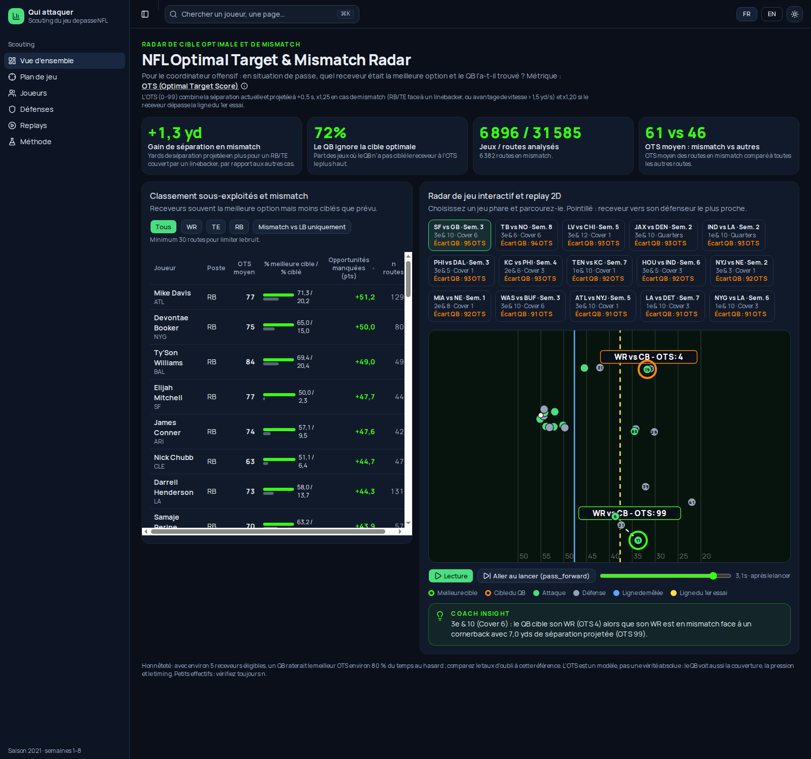

# NFL Optimal Target & Mismatch Radar 🏈

**À chaque passe, quel était le meilleur receveur à viser, et le QB l'a-t-il trouvé ?** Un outil de visionnage pour coordinateurs offensifs, basé sur les données de tracking Next Gen Stats. · [English](README.md)

- **Pour qui :** le coordinateur offensif qui revoit ses passes.
- **Situation :** l'instant du lancer (`pass_forward`) : parmi les 5 receveurs éligibles (WR/TE/RB), lequel était la meilleure option ?
- **Métrique, OTS (Optimal Target Score, 0–99) :** séparation du receveur avec le défenseur le plus proche, maintenant et projetée à +0,5 s, avec un bonus ×1,25 en mismatch (RB/TE couvert par un linebacker, ou avantage de vitesse > 1,5 yd/s) et ×1,20 s'il a dépassé la ligne du 1er essai. Le plus haut OTS du jeu est la « cible optimale », comparée au receveur réellement visé.
- **Résultat :** sur 6 896 passes et 31 585 routes, un RB/TE couvert par un linebacker gagne **+1,3 yd** de séparation projetée (OTS moyen **61 contre 46**), et le QB ne vise pas le receveur au plus haut OTS dans **72 %** des jeux. Le tableau de bord classe les receveurs les plus sous-exploités et rejoue les 15 jeux au plus grand écart.

**Lancer :** `docker compose -f web/docker-compose.yml up --build` (http://localhost:3000) ; `python3 scripts/build_metrics.py` recalcule les JSON (~10 s).

**Limites :** avec ~5 receveurs, viser ailleurs que le top OTS arrive ~80 % du temps au hasard, donc 72 % ne prouve pas une erreur du QB ; l'OTS est un modèle (ni lecture de couverture, ni pression). Les RB dominent le classement car souvent seuls dans l'espace. Cible réelle issue de nflverse ; saison 2021, semaines 1–8 ; corrélation, pas causalité.
