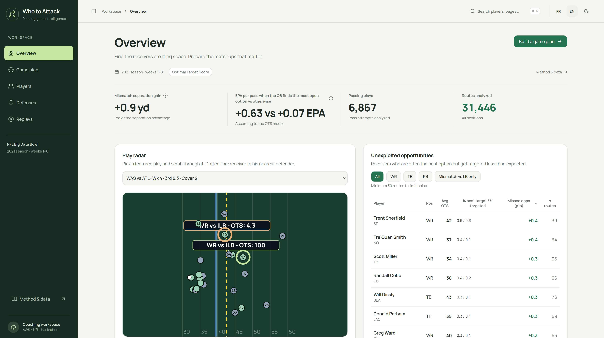

# Who to Attack 🏈

**Find the receivers creating space, and prepare the matchups that matter.** · [Français](README.fr.md)



Who to Attack helps NFL offensive coordinators decide which receivers and which defenses to target, using Next Gen Stats tracking. At the moment of the throw, each WR/TE/RB gets an **Optimal Target Score (0–99)** based on separation from the nearest defender, mismatches (e.g. a RB covered by a linebacker) and the first-down line. Across 6,867 passes, a mismatch is worth **+0.9 yd** of separation, and passes where the QB finds the most open option average **+0.63 EPA vs +0.07**. The app offers an animated play radar, a leaderboard of open-but-forgotten receivers, game plans, defense tendencies and replays, in FR/EN. OTS is a model (no coverage reads or pressure), on 2021 weeks 1–8 only: correlation, not causation.

```bash
docker compose -f web/docker-compose.yml up --build   # http://localhost:3000
```

*Data: NFL Big Data Bowl + PFF + nflverse. AWS × NFL hackathon, Paris, 21 Oct 2026.*
