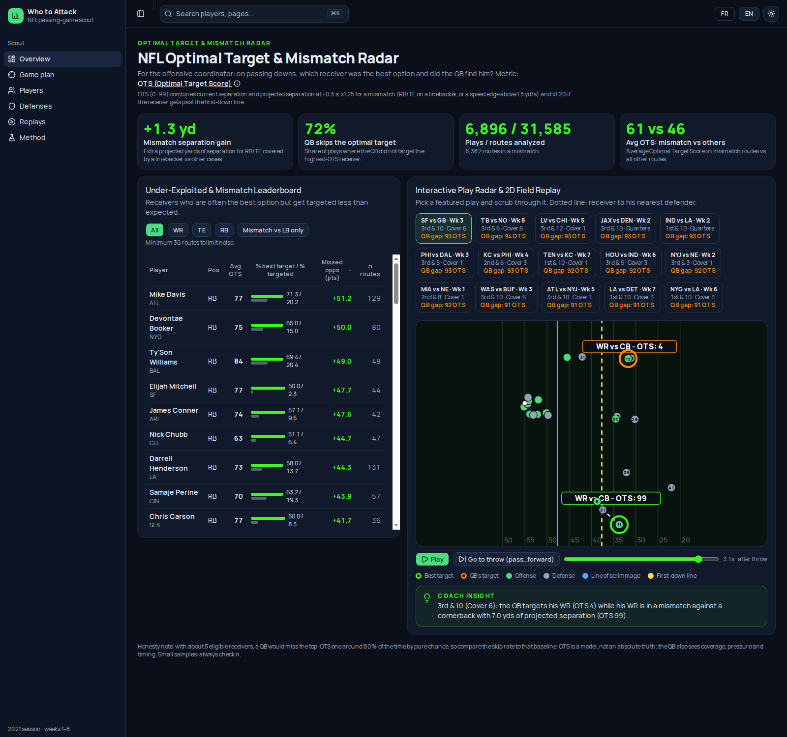

# NFL Optimal Target & Mismatch Radar 🏈

**On every pass, who was the best receiver to throw to, and did the quarterback find him?** A film-room tool for offensive coordinators, built on NFL Next Gen Stats tracking data. · [Français](README.fr.md)



## The idea

- **For whom:** the offensive coordinator reviewing pass plays.
- **Situation:** the moment the ball is thrown (`pass_forward`): which of the 5 eligible receivers (WR/TE/RB) was the best option?
- **Metric, OTS (Optimal Target Score, 0–99):** the receiver's separation from the nearest defender now and projected 0.5 s ahead, boosted ×1.25 for a mismatch (a RB/TE covered by a linebacker, or a speed edge above 1.5 yd/s) and ×1.20 if he is past the first-down line. The highest OTS on the play is the "optimal target", compared with the receiver actually targeted.
- **Result:** across 6,896 passes and 31,585 routes, a RB/TE covered by a linebacker gains **+1.3 yd** of projected separation (average OTS **61 vs 46**), and the QB throws to someone other than the top-OTS receiver on **72%** of plays. The dashboard lists the most under-exploited receivers and replays the 15 plays with the biggest gap (e.g. QB targets a WR at OTS 4 while a covered-by-LB receiver sits at OTS 99).

## Run it

```bash
docker compose -f web/docker-compose.yml up --build   # http://localhost:3000 (FR/EN)
python3 scripts/build_metrics.py                      # optional: recompute the JSON from data/ (~10 s)
```

Screenshots: [EN](docs/img/radar-en.png) · [FR](docs/img/radar-fr.png).

## Honest limits

- With about 5 receivers, throwing elsewhere than at the top-OTS receiver happens ~80% of the time by chance, so 72% is not proof the QB errs; OTS is a model, not the truth, and ignores coverage reads, pressure and route concept.
- Running backs dominate the leaderboard because they are often alone in space; compare within a position and mind the route counts shown.
- The targeted receiver comes from nflverse play-by-play (tracking stops ~0.5 s after the throw). 2021 season, weeks 1–8 only. Correlation, not causation.

*Data: NFL Big Data Bowl tracking + PFF scouting + nflverse. Built at the AWS × NFL hackathon, Paris, 21 Oct 2026.*
